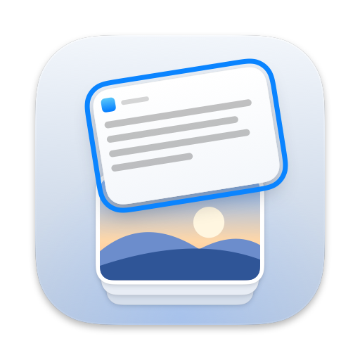
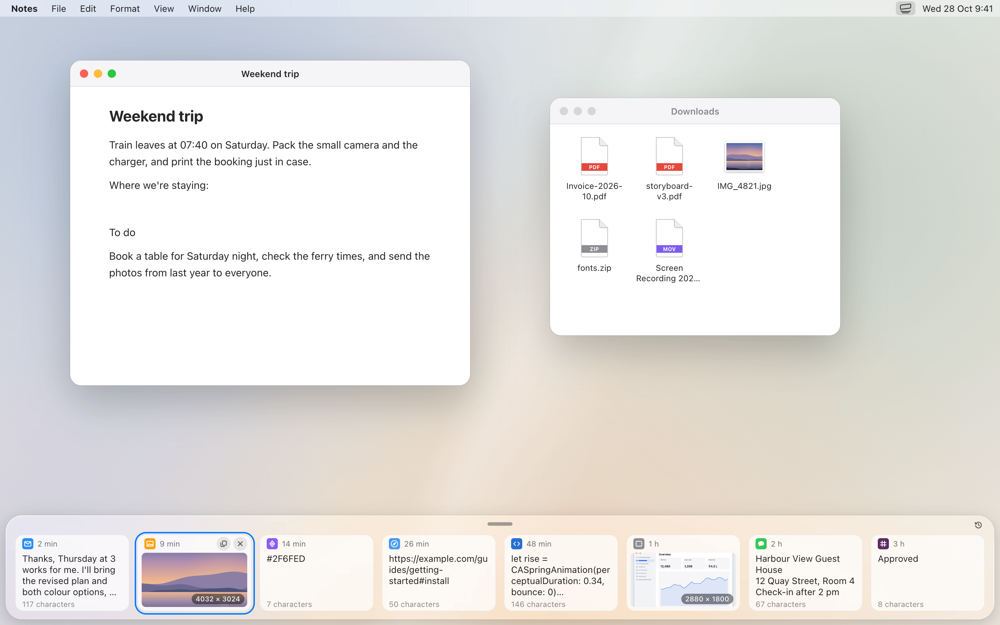
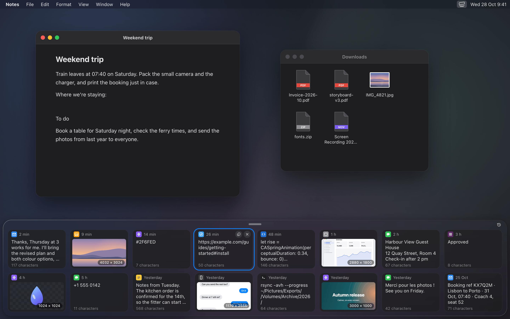
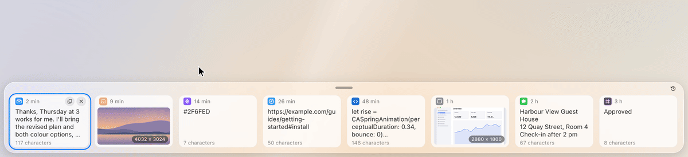
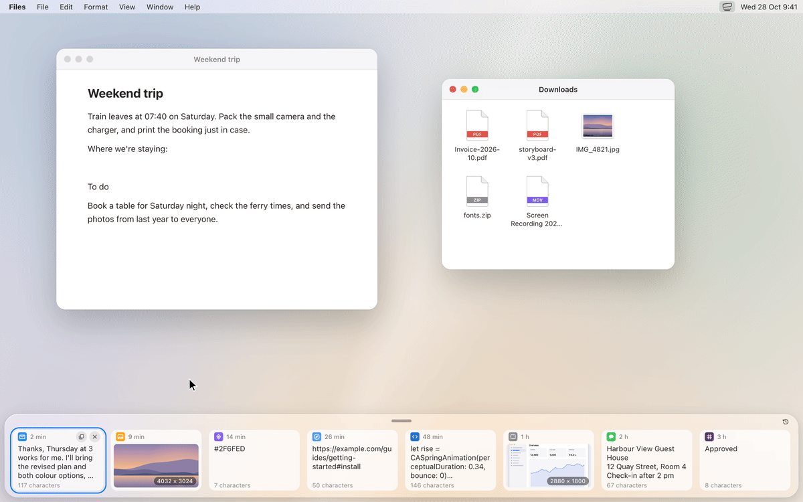
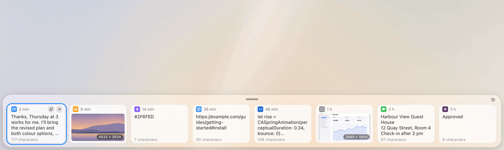
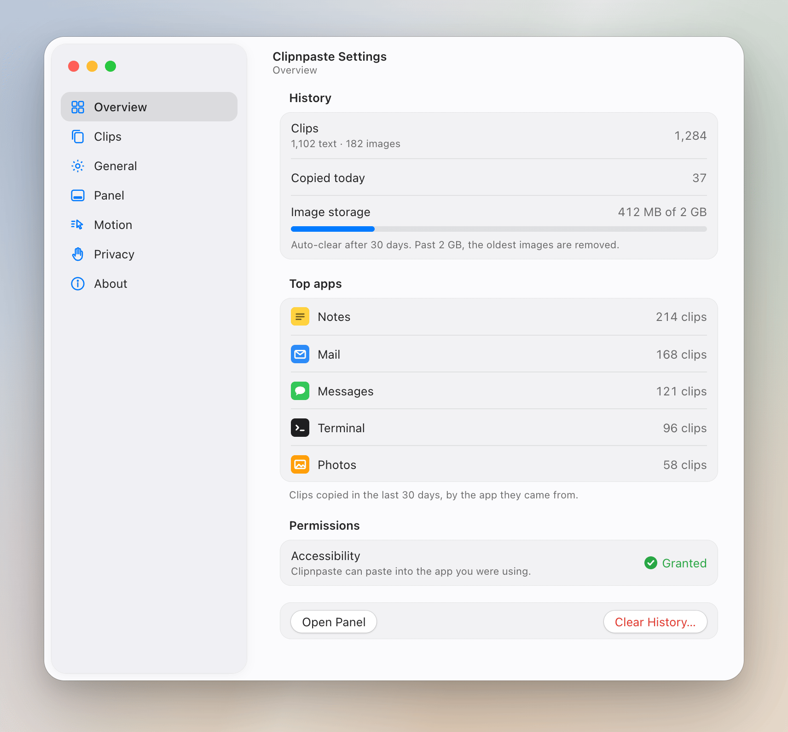

<div align="center">



# Clipnpaste

**A free, open-source clipboard manager for Mac, with a Liquid Glass panel.**

Every text and image you copy is saved. Press <kbd>⌃</kbd><kbd>⌘</kbd><kbd>V</kbd> and a frosted glass panel rises from the bottom of the screen with your clipboard history as a row of cards. Pick one and it pastes straight into the app you were in. A native macOS menu bar app that keeps everything on your Mac, with no account and no network.


<br>

<a href="https://github.com/irfanabdulhameed/clipnpaste/releases/latest/download/Clipnpaste.dmg"></a>

<sub>macOS 26 Tahoe or later · free and open source · <a href="#download">first-time setup</a></sub>

<br><br>



<br><br>

[Features](#features) · [How to use](#how-to-use-the-clipboard-history-panel) · [Settings](#settings) · [Privacy](#privacy) · [Download](#download) · [Build from source](#build-from-source) · [Permissions](#permissions) · [FAQ](#faq)

</div>

<br>

## What is Clipnpaste?

Clipnpaste is a **clipboard manager for Mac** that remembers what you copied so you can paste it again. It keeps your **clipboard history on macOS** as text previews and image thumbnails, and shows them in a Liquid Glass panel designed for **macOS 26 Tahoe**. The panel is one sixth of the screen tall and holds a row of eight cards, so you can see a lot of history at once and still keep working underneath it.

It is made for one job: **paste previous clipboard items on a Mac** quickly, without opening another window. Copy as usual, press the shortcut, pick a card.

## Features

- **Saves every text and image you copy.** Each card shows a preview, the icon of the app you copied from and the time.
- **A Liquid Glass panel.** It rises from the bottom of the screen, is 1/6 of the screen tall and shows eight landscape cards in a row.
- **Paste straight into the app you were in.** Move with the arrow keys and press <kbd>Return</kbd>, or click a card.
- **Your own shortcut.** <kbd>⌃</kbd><kbd>⌘</kbd><kbd>V</kbd> by default. Record a different one from the menu bar icon.
- **Copy and remove buttons on every card.** Copy a clip again without pasting it, or delete it for good.
- **Reorder by dragging.** Drag a card sideways and the others move aside to open a slot.
- **Drag a card out into any app.** Drop an image into Finder or Mail, or text into a text field. While you drag, the panel shrinks to a thin strip so it stays out of the way, then grows back.
- **Up to three rows.** Drag the pill at the top of the panel to make it one, two or three rows tall. After that it scrolls.
- **History mode, by day.** Press <kbd>⌘</kbd><kbd>Y</kbd> to see everything you copied, grouped by day.
- **Skips passwords.** Copies that apps mark as concealed or transient, such as password manager entries, are never saved.
- **Launch at login.** Turn it on from the menu bar icon.
- **A menu bar app.** No Dock icon and no window in your way.
- **Smooth, calm motion.** Every animation uses springs with no overshoot.
- **Follows your Mac's settings.** Light and Dark mode, Reduce Motion, Reduce Transparency and Increase Contrast.



## How to use the clipboard history panel

1. Copy text or an image in any app, as you always do.
2. Press <kbd>⌃</kbd><kbd>⌘</kbd><kbd>V</kbd>. The glass panel rises from the bottom of the screen.
3. Pick a clip with the arrow keys and press <kbd>Return</kbd>, or click it. The panel closes and the clip is pasted into the app you were in.


### Keyboard shortcuts

| Shortcut | What it does |
|---|---|
| <kbd>⌃</kbd><kbd>⌘</kbd><kbd>V</kbd> | Open the panel from anywhere (you can record your own) |
| <kbd>←</kbd> <kbd>→</kbd> | Move the selection between cards |
| <kbd>Return</kbd> | Paste the selected clip into the app you were in |
| <kbd>⌥</kbd><kbd>⌘</kbd><kbd>←</kbd> / <kbd>→</kbd> | Move the selected card one place left or right |
| <kbd>⌘</kbd><kbd>Y</kbd> | Switch between the card row and history by day |
| <kbd>Esc</kbd> | Close the panel |

### Make the panel taller

Drag the pill at the top centre of the panel. It snaps to one, two or three rows. At three rows, the content scrolls. History mode stays within three rows too.


### Reorder clips

Drag a card sideways. The other cards move apart to open a slot under the pointer, and the card lands there when you let go. From the keyboard, <kbd>⌥</kbd><kbd>⌘</kbd><kbd>←</kbd> and <kbd>⌥</kbd><kbd>⌘</kbd><kbd>→</kbd> move the selected card one place.



### Drag a clip into another app

Drag a card out of the panel and drop it where you want it. Images go to Finder, Mail and anything else that takes files. Text goes into a text field. The panel shrinks to a thin strip while you drag, so the app underneath is free to drop on, and grows back afterwards.



### See your history by day

Press <kbd>⌘</kbd><kbd>Y</kbd>, or click the clock button at the top right of the panel. Every clip appears grouped under Today, Yesterday and the days before, and you can scroll back through them. Press <kbd>⌘</kbd><kbd>Y</kbd> again to go back to the row of cards.



## Settings

Open **Settings** from the menu bar icon. The window has seven sections:

- **Overview.** How many clips you have, how many you copied today, image storage against its 2 GB limit, the apps you copy from most, and whether Accessibility is on.
- **Clips.** Browse and search everything Clipnpaste has saved, and delete clips one by one or all at once.
- **General.** Your shortcut, launch at login, which screen the panel opens on, and whether Clipnpaste shows in the menu bar and the Dock.
- **Panel.** How many rows it opens with, when the card buttons show, Light or Dark appearance, and the glass style.
- **Motion.** How cards tilt, pop and arrive, what the panel does while you drag a card out, and Reduce Motion.
- **Privacy.** How many clips and how much image storage to keep, **auto-clear** for clips older than a day, a week, 30 days, 90 days or a year, copies from iPhone and iPad, and apps whose copies are never saved.
- **About.** The version and a link to this page.



<sub>The pictures and animations on this page are rendered from a design mock-up of Clipnpaste with sample clips.</sub>

## Privacy

Clipnpaste is a **local-only clipboard manager**. Your clipboard can hold passwords, messages and private photos, so nothing about it leaves your Mac.

- **No network.** Clipnpaste makes no connections at all.
- **No account, no telemetry, no analytics.**
- **Stored on your Mac only.** Clips live in a SQLite database and image files in `~/Library/Application Support/Clipnpaste`.
- **Passwords are skipped.** Copies that apps mark as concealed, such as those from password managers, are not saved.
- **You stay in control.** Remove any clip from its card. To remove everything, quit Clipnpaste and delete its Application Support folder.

## Download

<p align="center">
  <a href="https://github.com/irfanabdulhameed/clipnpaste/releases/latest/download/Clipnpaste.dmg"></a>
</p>

<p align="center">Requires macOS 26 Tahoe or later. Free and open source. This is version 0.1.0, the first release.</p>

**The first time you open it:**

1. Open **Clipnpaste.dmg** and drag **Clipnpaste** onto **Applications**.
2. Open Clipnpaste from Applications. Clipnpaste isn't notarized by Apple yet, so macOS says it can't check it. Click **Done** (or **OK**).
3. Open **System Settings › Privacy & Security**, scroll down to **Security**, and click **Open Anyway** next to the line about Clipnpaste. Confirm with your password or Touch ID, then click **Open**.
4. Turn on **Accessibility** for Clipnpaste in **System Settings › Privacy & Security › Accessibility**, so it can paste for you. See [Permissions](#permissions).

You only do this once. After that, the Clipnpaste icon sits in your menu bar and <kbd>⌃</kbd><kbd>⌘</kbd><kbd>V</kbd> opens the panel.

## Build from source

You can also build Clipnpaste yourself. You need Apple's Command Line Tools. Xcode is not required, and there are no third-party dependencies.

**Requirements**

- macOS 26 Tahoe (Apple Silicon or Intel)
- Command Line Tools for Xcode: `xcode-select --install`

**Steps**

```bash
git clone https://github.com/irfanabdulhameed/clipnpaste.git
cd clipnpaste
./scripts/build.sh --run
```

`build.sh` builds a release `Clipnpaste.app` into `build/`, installs it in `~/Applications` and, with `--run`, opens it. The Clipnpaste icon appears in the menu bar.

Other build options:

```bash
INSTALL=0 ./scripts/build.sh                      # build only, don't install
CLIPNPASTE_SIGN_ID="My Certificate" ./scripts/build.sh   # sign with your own certificate
./scripts/make-dmg.sh                             # build dist/Clipnpaste.dmg, the file people download
./scripts/test.sh                                 # run the test suite
```

If the signing certificate isn't found, the script signs ad hoc and warns you. With an ad-hoc signature, macOS forgets the Accessibility permission after each rebuild, so use a stable certificate of your own if you rebuild often.

## Permissions

Clipnpaste needs one permission: **Accessibility**. It is used for one thing only, sending <kbd>⌘</kbd><kbd>V</kbd> to the app you were in so a clip pastes for you. Clipnpaste does not read your screen or your keystrokes.

**To turn it on:** open **System Settings › Privacy & Security › Accessibility**, add Clipnpaste and switch it on. The menu bar icon shows whether it is on.

Without it, Clipnpaste still saves your history and puts the clip you pick on the clipboard, so you can paste it with <kbd>⌘</kbd><kbd>V</kbd> yourself.

## Under the hood

- **Native and small.** Swift 6, AppKit and Core Animation for the panel, cards and drag, SwiftUI for the small settings. No Electron, no web views and no third-party libraries.
- **Watching the clipboard.** macOS has no clipboard-change notification, so Clipnpaste checks the pasteboard's change counter twice a second, and less often when you are away.
- **Storing clips.** Text and image metadata go into SQLite through a small wrapper of its own. Images are saved as files with a thumbnail made at copy time.
- **The panel.** One long-lived, non-activating `NSPanel` with a Liquid Glass surface, built once and raised on the shortcut, so it opens at once and never takes focus from your app.
- **Pasting.** The picked clip is written to the clipboard and <kbd>⌘</kbd><kbd>V</kbd> is sent to the app you were in.
- **Motion.** Springs with no overshoot, tuned for a calm feel.

```
Sources/ClipnpasteCore/   clipboard watcher, capture rules, SQLite store, thumbnails, layout (tested)
Sources/Clipnpaste/       the app: menu bar, glass panel, cards, drag, shortcut, paster
Tests/                    unit tests for the core
scripts/                  build.sh, make-dmg.sh, test.sh
```

## FAQ

### What is the best way to get a clipboard manager on Mac for free?
Clipnpaste is free and open source under the MIT licence. Download it from the [Download](#download) section or build it from source.

### How do I see my clipboard history on a Mac?
Install Clipnpaste, copy as usual, then press <kbd>⌃</kbd><kbd>⌘</kbd><kbd>V</kbd>. Every text and image you copied appears as a card. Press <kbd>⌘</kbd><kbd>Y</kbd> to see all of it grouped by day.

### How do I paste previous clipboard items on a Mac?
Open the panel, move to the clip you want with the arrow keys and press <kbd>Return</kbd>, or click it. It pastes into the app you were in.

### Does it work with macOS Tahoe and Liquid Glass?
Yes. Clipnpaste is made for macOS 26 Tahoe and uses its Liquid Glass material. It needs macOS 26 or later.

### Does it work on Intel Macs?
The package has no architecture limit, so it builds for the Mac you build it on, Apple Silicon or Intel, as long as it runs macOS 26.

### Is it safe? Does it save my passwords?
Clipnpaste skips copies that apps mark as concealed, such as password manager entries. Everything it does save stays on your Mac, and it has no network access of any kind.

### Does Clipnpaste send my clipboard anywhere?
No. There is no account, no sync, no analytics and no network code.

### What does it save?
Text and images. Each clip keeps its source app and the time.

### Can I change the keyboard shortcut?
Yes. Record your own from the menu bar icon. The default is <kbd>⌃</kbd><kbd>⌘</kbd><kbd>V</kbd>.

### Why does it ask for Accessibility access?
To send <kbd>⌘</kbd><kbd>V</kbd> to the app you were in. See [Permissions](#permissions).

### How do I open Clipnpaste when I log in?
Turn on **Launch at login** in the menu bar icon's menu.

### How do I delete my clipboard history?
Remove single clips with the remove button on each card. To delete everything, quit Clipnpaste and delete `~/Library/Application Support/Clipnpaste`.

### How do I reorder or drag clips out?
Drag a card sideways to reorder, or out of the panel into any app to drop it there.

### Does it support Reduce Motion and Dark mode?
Yes. It follows Light and Dark mode, Reduce Motion, Reduce Transparency and Increase Contrast.

## License

[MIT](LICENSE) © 2026 Irfan Abdul Hameed
