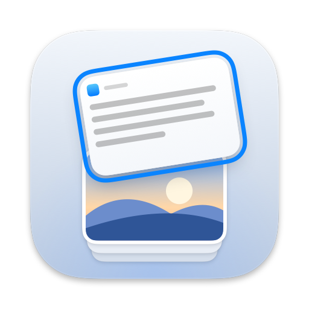
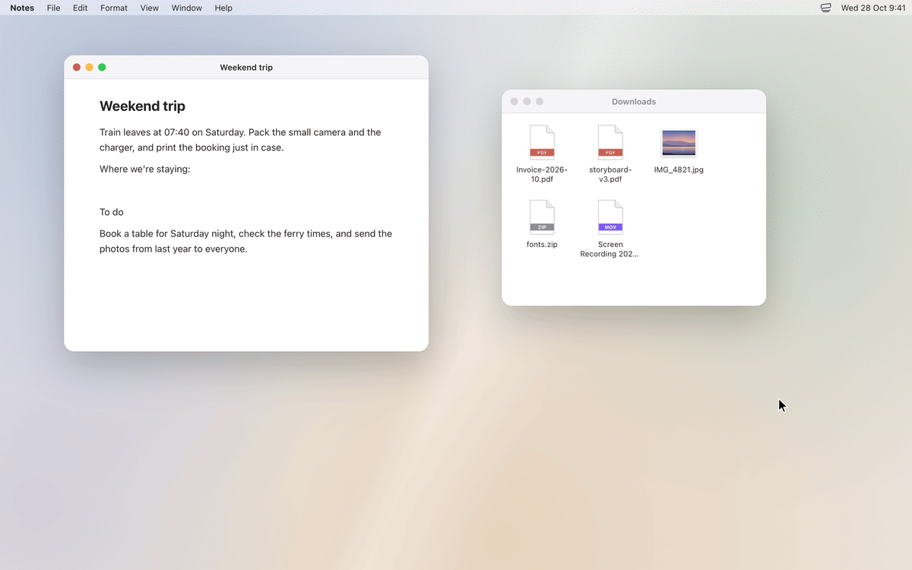
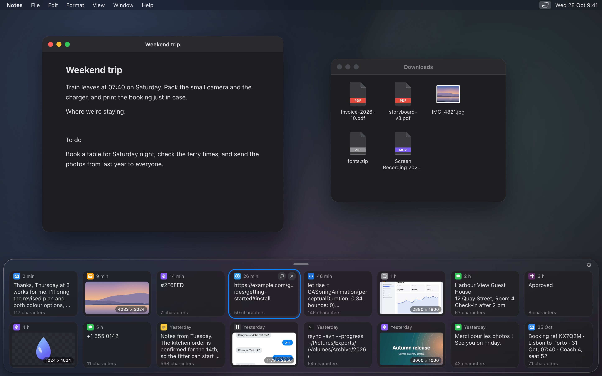
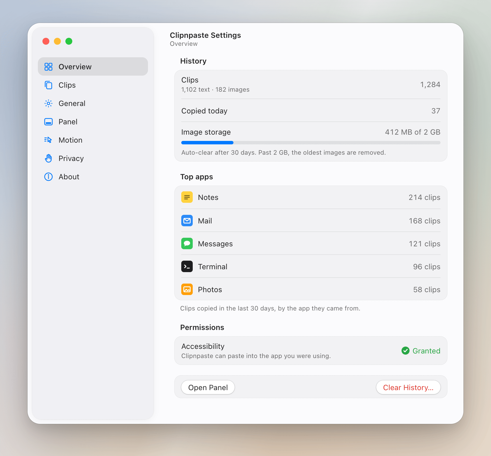
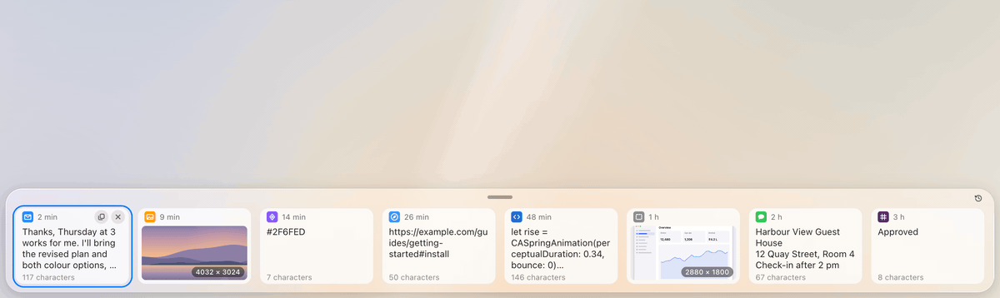

<div align="center">



# Clipnpaste

**A free, open-source clipboard manager for Mac, with a Liquid Glass panel.**


[**Download**](https://github.com/irfanabdulhameed/clipnpaste/releases/latest/download/Clipnpaste.dmg) · [**Website & contributing guide**](https://irfanabdulhameed.github.io/clipnpaste/) · [Build from source](#build-from-source) · [FAQ](#faq)



</div>

Every text and image you copy is saved. Press <kbd>⌃</kbd><kbd>⌘</kbd><kbd>V</kbd>, pick a card, and it pastes into the app you were in. Native, local-only, no account.

## Contents

- [Features](#features)
- [Install](#install)
- [Usage](#usage)
- [Privacy](#privacy)
- [Build from source](#build-from-source)
- [Project layout](#project-layout)
- [Contributing](#contributing)
- [FAQ](#faq)
- [License](#license)

## Features

| | |
|---|---|
| **Liquid Glass panel** | Rises from the bottom of the screen, one to three rows of cards |
| **Paste in place** | Arrow keys + <kbd>Return</kbd>, or click. Pastes into the app you were in |
| **Drag in and out** | Reorder by dragging; drag a card into Finder, Mail or a text field |
| **History by day** | <kbd>⌘</kbd><kbd>Y</kbd> groups everything under Today, Yesterday, … |
| **Skips passwords** | Concealed and transient copies are never saved |
| **Auto-clear** | Remove clips older than a day, week, 30/90 days or a year |
| **Fits your Mac** | Light/Dark, Reduce Motion, Reduce Transparency, Increase Contrast |
| **Menu bar app** | No Dock icon, launch at login, custom shortcut |

## Install

1. [Download Clipnpaste.dmg](https://github.com/irfanabdulhameed/clipnpaste/releases/latest/download/Clipnpaste.dmg) and drag **Clipnpaste** to **Applications**. Requires macOS 26 Tahoe.
2. Open it. It isn't notarized yet, so macOS blocks it the first time: click **Done**, then go to **System Settings › Privacy & Security** and click **Open Anyway**.
3. Turn on **Accessibility** for Clipnpaste in **System Settings › Privacy & Security › Accessibility**. It's used only to send <kbd>⌘</kbd><kbd>V</kbd> to your app. Without it, the clip is put on the clipboard and you paste it yourself.

Updates: Clipnpaste checks GitHub once a day and shows **Update to …** in its menu. Turn this off in **Settings › About**.

## Usage

| Shortcut | Action |
|---|---|
| <kbd>⌃</kbd><kbd>⌘</kbd><kbd>V</kbd> | Open the panel (recordable) |
| <kbd>←</kbd> <kbd>→</kbd> | Move the selection |
| <kbd>Return</kbd> | Paste the selected clip |
| <kbd>⌘</kbd><kbd>⌫</kbd> | Remove the selected clip |
| <kbd>⌥</kbd><kbd>⌘</kbd><kbd>←</kbd> / <kbd>→</kbd> | Move the selected card |
| <kbd>⌘</kbd><kbd>Y</kbd> | Toggle history by day |
| <kbd>Esc</kbd> | Close |

Drag the pill at the top of the panel to resize it to one, two or three rows. Settings (menu bar icon › **Settings**) has Overview, Clips, General, Panel, Motion, Privacy and About.

<details>
<summary>More screenshots</summary>
<br>



</details>

## Privacy

- Clips stay on your Mac in `~/Library/Application Support/Clipnpaste` (SQLite + image files).
- No account, sync, telemetry or analytics.
- The only network request is the GitHub update check. It sends nothing about you or your clips.
- To erase everything, quit Clipnpaste and delete that folder.

## Build from source

Needs macOS 26 and the Command Line Tools (`xcode-select --install`). No Xcode, no third-party dependencies.

```bash
git clone https://github.com/irfanabdulhameed/clipnpaste.git
cd clipnpaste
./scripts/build.sh --run      # build, install to ~/Applications, open
```

```bash
INSTALL=0 ./scripts/build.sh                            # build only
CLIPNPASTE_SIGN_ID="My Certificate" ./scripts/build.sh  # sign with your certificate
./scripts/test.sh                                       # run the tests
./scripts/make-dmg.sh                                   # build dist/Clipnpaste.dmg
```

Without a certificate the build is signed ad hoc, and macOS forgets the Accessibility permission after each rebuild. Use a stable certificate if you rebuild often.

## Project layout

```
Sources/ClipnpasteCore/   clipboard watcher, capture rules, SQLite store, layout, motion (tested)
Sources/Clipnpaste/       the app: menu bar, glass panel, cards, drag, shortcut, paster, settings
Tests/                    swift-testing suite for the core
scripts/                  build.sh, test.sh, make-dmg.sh
docs/                     website (GitHub Pages) and screenshots
```

Swift 6, AppKit and Core Animation for the panel, SwiftUI for Settings. The panel is a single non-activating `NSPanel`, so it never takes focus from your app.

## Contributing

Bug reports, fixes, features, docs and accessibility testing are all welcome. Start with the [contributing guide](https://irfanabdulhameed.github.io/clipnpaste/#contribute) or [CONTRIBUTING.md](CONTRIBUTING.md), then pick an [issue](https://github.com/irfanabdulhameed/clipnpaste/issues).

## FAQ

<details><summary><b>Does it work on Intel Macs?</b></summary>
It builds for whatever Mac you build it on, Apple Silicon or Intel, as long as it runs macOS 26.
</details>

<details><summary><b>Is it safe? Does it save passwords?</b></summary>
It skips copies apps mark as concealed, such as password manager entries. Everything else stays on your Mac.
</details>

<details><summary><b>What does it save?</b></summary>
Text and images, each with its source app and time.
</details>

<details><summary><b>How do I change the shortcut or launch at login?</b></summary>
From the menu bar icon, or <b>Settings › General</b>.
</details>

<details><summary><b>How does it update itself?</b></summary>
It asks GitHub for the latest version, verifies the download is signed by the same developer, replaces itself and relaunches. Clips and settings are kept, and it never updates mid-paste or mid-drag.
</details>

## License

[MIT](LICENSE) © 2026 Irfan Abdul Hameed
